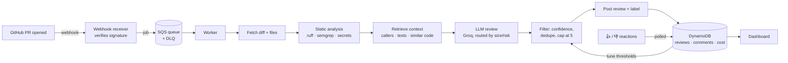

# 🤖 ReviewBot — a context-aware, low-noise AI pull-request reviewer

ReviewBot is a GitHub App. When someone opens a pull request, it posts within about 30 seconds:

- a **summary** of what the PR changes and its likely impact
- a **risk label** (low / medium / high) with reasons such as *"touches auth logic, no tests added"*
- a **few high-confidence inline comments**, often with a one-click **suggested change**
- **suggested test cases** for changed functions that have no tests

Developers react 👍 or 👎 to each comment. The bot reads those reactions and raises the confidence bar for categories people find unhelpful.

## How it works



| Step | Where in the code |
|---|---|
| Webhook + signature check | `reviewbot/server.py`, `reviewbot/signature.py`, `lambdas/webhook_handler.py` |
| Queue | `reviewbot/job_queue.py` (SQS; ElasticMQ locally) |
| Diff parsing + chunking | `reviewbot/diff_parser.py` |
| Static analysis | `reviewbot/analysis/` + `config/semgrep_rules.yml` |
| Code index (embeddings + pgvector) | `reviewbot/retrieval/` |
| Prompt + LLM + model routing | `reviewbot/prompts.py`, `reviewbot/llm.py` |
| Risk estimate | `reviewbot/risk.py` |
| Filtering | `reviewbot/filtering.py` |
| Orchestration | `reviewbot/pipeline.py`, `reviewbot/github_review.py` |
| Feedback + threshold tuning | `reviewbot/feedback.py` |
| Storage | `reviewbot/storage.py` (DynamoDB; DynamoDB Local locally) |
| Dashboard | `dashboard/index.html`, `reviewbot/stats.py` |
| Evaluation | `eval/` |
| AWS infrastructure | `infra/` (CDK), `lambdas/`, `Dockerfile.lambda` |

## Tech stack

| Layer | Choice |
|---|---|
| Integration | GitHub App (webhooks + REST API), one-click setup via App manifest |
| Compute | Docker Compose locally · AWS Lambda + API Gateway in the cloud |
| Queue | SQS with dead-letter queue (ElasticMQ locally) |
| LLM | Groq: `gpt-oss-20b` for small diffs, `gpt-oss-120b` for large/risky ones |
| Retrieval | FastEmbed (`bge-small-en-v1.5`, runs on CPU for free) + Postgres pgvector |
| Static analysis | Ruff, Semgrep (own rule set), a regex + entropy secret scanner |
| Storage | DynamoDB (DynamoDB Local locally) |
| Dashboard | Small web page served by the bot, plus a CloudWatch dashboard on AWS |
| CI/CD and IaC | GitHub Actions, AWS CDK (Python) |

## Run it locally (about 10 minutes)

You need Docker and a free Groq API key from https://console.groq.com/keys.

**1. Add your key**

```bash
cp .env.example .env
# open .env and paste your key after GROQ_API_KEY=
```

**2. Start everything**

```bash
docker compose up --build -d
```

**3. Create the GitHub App:** open http://localhost:8000/setup and click **Create GitHub App**. GitHub asks you to confirm, then takes you to the install page. Install it on your sample repo (see below).

**4. See it work:** create an empty repo on GitHub called `reviewbot-sample` (no README), install the App on it, then run:

```bash
docker compose run --rm worker python -m scripts.seed_sample_repo --repo YOUR_GITHUB_NAME/reviewbot-sample
```

This uploads a small shop backend and opens 8 pull requests with planted bugs. Reviews appear on each PR within about a minute. React 👍/👎 to the comments, then watch http://localhost:8000/dashboard.

Useful commands:

```bash
docker compose logs -f worker      # watch reviews happen
docker compose down                # stop (data is kept in ./data)
```

## Measure it

```bash
docker compose run --rm worker python -m eval.run_eval
docker compose run --rm worker python -m eval.run_eval --no-retrieval   # ablation without the code index
```

The evaluation set (`eval/cases.py`) has **50 PRs**: 40 with 42 seeded bugs (SQL injection, inverted auth checks, float money, swallowed errors, IDOR, race conditions, off-by-one, …) and 10 clean PRs. The script reports catch rate, false-positive rate, noise on clean PRs, latency and cost, and writes a Markdown report to `eval/results/`.

On Groq's free tier, run it with the default 2-second pause between cases. Add `--limit 10` for a quick check.

## Configure per repository

Add `.reviewbot.yml` to the repo's default branch:

```yaml
strictness: normal        # relaxed | normal | strict
max_comments: 5
ignore_paths:
  - "docs/**"
rules:
  - "All SQL must go through db.py and use parameters."
  - "Money is always integer paise, never float."
```

## Deploy to AWS

See [docs/AWS_DEPLOY.md](docs/AWS_DEPLOY.md). The CDK stack creates API Gateway, the webhook/worker/feedback/dashboard Lambdas, SQS with a DLQ and alarm, the DynamoDB tables, a Secrets Manager secret and a CloudWatch dashboard.

## Run the tests

```bash
pip install -r requirements-dev.txt
pytest -q
```

The tests run without network access. They use a fake LLM, an in-memory vector store, moto for AWS, and a fake GitHub API for the full review flow.

## Key design decisions

- **Static analysis plus an LLM instead of an LLM alone.** Deterministic tools catch concrete issues cheaply and reliably. Their findings are passed to the LLM as hints, which grounds its comments and reduces hallucinations. Secrets are always reported, even if the LLM misses them.
- **Retrieval.** A diff alone leads to generic comments. For each changed function the bot pulls callers, existing tests and similar code from the index, which is updated incrementally (by git blob SHA) on every push to main.
- **Cap and filter comments.** Comments must sit on diff lines, pass a per-category confidence bar, and are de-duplicated and capped at 5 per PR. Three good comments get read; twenty mediocre ones get muted.
- **A queue between webhook and worker.** GitHub expects an answer within 10 seconds, and the queue absorbs bursts. Failed jobs retry automatically and land in a DLQ after three attempts.
- **Proving it's good.** A seeded-bug evaluation set measures catch rate and false positives offline. In production, 👍/👎 reactions give a real helpfulness rate.
- **Cost control.** Model routing by diff size and risk, caching of static analysis per file version and of LLM results per chunk (so pushing an unrelated commit does not re-review unchanged files), and cost logged per PR.
- **Feedback loop.** Every 5–10 minutes the bot reads reactions. A category with fewer than 40% 👍 (at least 5 votes) needs +0.1 confidence; one with more than 80% 👍 gets −0.05.

## Resume bullets (fill in your own numbers)

- Built a GitHub App that reviews PRs by combining static analysis and retrieval-augmented LLM review, with **X%** of comments rated helpful across **N** PRs.
- Caught **X of 42** seeded bugs in a 50-PR evaluation set with a **Y%** false-positive rate, using confidence filtering and codebase-aware context.
- Reached an average **Zs** review at **₹W per PR** through model routing and caching, with an SQS-based async pipeline deployable to AWS Lambda via CDK.

Get the numbers from `eval/results/latest-full.md` and the dashboard.
